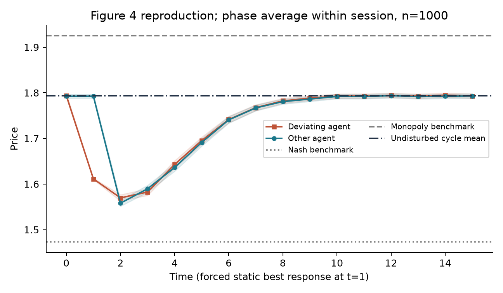
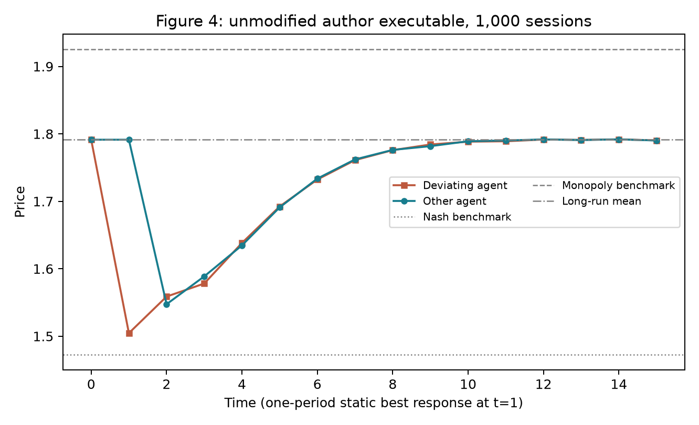
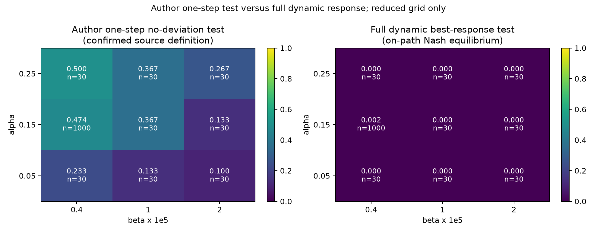

# 复现报告：Artificial Intelligence, Algorithmic Pricing, and Collusion

完成日期：2026-10-23。对象：Calvano, Calzolari, Denicolò and Pastorello (2020), *AER* 110(10): 3267–3297，DOI [10.1257/aer.20190623](https://www.aeaweb.org/articles?id=10.1257/aer.20190623)。以下数值均来自项目实际运行；论文目标值为人工转录，另存于 `data/reference/paper_targets.csv`。

## 1. 结论与复现程度

已成功运行**作者未修改的Fortran程序1,000次**，并另用独立Python实现运行1,000次基准实验。作者程序平均利润增益 **.84872**、总体标准差 **.11198**、作者路径一步检验通过率 **.505**，均与论文Table1的三位小数 **.849 / .112 / .505** 一致。原程序1,000次全部收敛。

Python平均利润增益 **.84912455**，相对论文 **.849** 的绝对误差 **.00012455**、相对误差 **.01467%**；样本标准差 **.11206550**。同时复现偏离后的有限价格惩罚与逐步恢复高价。

**基准核心统计得到作者原程序复现，整篇仍为部分复现。** 全网格及全部鲁棒性未执行。经核对源码，作者的一步偏离诊断与完整动态最优响应定义不同；后者作为额外核查保留，不能直接拿来计算原表误差。

| 等级 | 内容 |
|---|---|
| 按原文明确方程完整实现并验证 | 基准logit博弈、连续基准、15档价格、同时Q更新、初始化、ε衰减、全状态策略稳定停止、冻结策略周期与单期偏离路径 |
| 作者原程序数值复现 | 基准1,000次Table1完整7组×8项共56个单元格，与原表三位小数精度一致 |
| 数值近似复现 | Python双企业1,000次利润和周期分布；源码对应的一步Q损失；图4机制；三/四企业小样本利润；无记忆对照的方向 |
| 未复现/未验证 | 从源码重新编译及执行R流程、100×100全网格、随机需求/进入退出/不对称/两期记忆/全部初始化与价格集鲁棒性、原图逐点数值 |

## 2. 材料与原代码核查

用户压缩包包含正确论文、附录及完整作者复现包。初审曾误将当前目录已有的1.5MB库存研究ZIP当作上传包成员；最后逐字节哈希检查发现并纠正了这一对应错误。真实内层包为27,317,813字节，SHA256为 `b4d16499f35de197c929465001cd23650a99f84244e0378290444d7284f8a9b1`，含 `AER_fcode`、原程序、R脚本、软件指南与输入文件。错误来源判断已从全部交付说明中纠正，不能归因于用户材料。

官方归档为 [openICPSR 119462 V1](https://doi.org/10.3886/E119462V1)。已直接使用用户包内源码核查，无需重新下载。按原MIT及作者致谢条款保存210个原始文件于 `vendor/calvano_original/`，有逐文件哈希。作者程序使用现有安装的Intel OpenMP运行库成功执行；程序字节未修改，第三方运行库不随项目分发。完整来源、许可及实现差别见 [来源审计](notes/source_audit.md)、[输入清单](notes/source_manifest.json)、[作者代码核查](notes/author_code_audit.md) 和 [原代码运行说明](docs/ORIGINAL_CODE.md)。公开项目不附送论文PDF及其全文提取文本。

## 3. 研究问题与模型

问题是：没有通信或合谋指令的独立强化学习定价算法，是否会在反复竞争中形成高于静态竞争均衡的价格，以及这种价格是否由惩罚偏离的策略维持。

企业同时报价，产品有差异化和外部选项。企业 $i$ 的需求与利润为：

$$q_i(\mathbf p)=\frac{\exp((a_i-p_i)/\mu)}{\sum_j\exp((a_j-p_j)/\mu)+\exp(a_0/\mu)},\qquad \pi_i=(p_i-c_i)q_i.$$

基准参数：$n=2,c_i=1,a_i=2,a_0=0,\mu=.25,\delta=.95$。每个企业15个价格，均匀覆盖 $[p_i^N-.1(p_i^M-p_i^N),p_i^M+.1(p_i^M-p_i^N)]$。状态是上一期全部企业价格，因此有 $15^2=225$ 个状态，每企业Q表有3,375格。没有缩减状态或离散动作数。

连续竞争均衡满足 $p_i-c_i=\mu/(1-q_i)$；联合利润最大化求共同加成。实际求解：

| 基准 | 每企业价格 | 每企业单期利润 |
|---|---:|---:|
| 静态Bertrand–Nash | 1.4729266600 | .2229266600 |
| 联合利润最大化 | 1.9249809190 | .3374904595 |

价格格点范围为1.4277212341至1.9701863449，步长约.0387475079。连续基准一般不在离散格点上；归一化仍采用论文连续基准。

## 4. 算法与实现

代表性参数为 $\alpha=.15,\beta=4\times10^{-6}$，探索概率 $\epsilon_t=\exp(-\beta t)$，从 $t=0$ 开始。探索时在15档价格中均匀抽样；否则取Q值最大动作，平局选择最低价格。

$$Q_{i,t+1}(s_t,a_{i,t})=(1-\alpha)Q_{i,t}(s_t,a_{i,t})+\alpha\left[\pi_{i,t}+\delta\max_a Q_{i,t}(s_{t+1},a)\right].$$

只更新访问单元。所有企业先用旧Q选择动作并计算目标，再同时更新，避免把顺序更新误当同时博弈。初始化为对手均匀随机定价的期望利润除以 $1-\delta$；初始状态均匀抽样。

停止标准是**每个企业在每个状态的贪婪动作连续100,000期完全不变**，不是仅当前价格不变，也不是Q值误差阈值。每期只有一个状态行改变，因此只检查该行的贪婪动作改变，与逐期扫描整张策略表等价。Numba仅加速相同表格算法，没有引入近似函数或改动状态空间。

冻结学习与探索后，确定性策略最终进入有限循环。利润、价格和诊断对循环全部相位等权，每次会话再等权。归一化指标为 $\Delta=(\bar\pi-\pi^N)/(\pi^M-\pi^N)$；标准差按每次会话的双企业平均Δ计算。

## 5. 实际计算范围与可重复性

Python主批次共2,280次：基准1,000次，另外8个网格点各30次，三企业30次，四企业10次，无记忆1,000次。额外对四企业同10个种子按原文上限重跑，Python训练任务合计2,290次（不把重复种子说成独立新增样本）。另执行作者程序基准1,000次及2次安装检查；检查和种子重放不并入独立样本数。

| 实验 | α | β | 状态/每企业Q格 | 样本数 | 上限 |
|---|---:|---:|---:|---:|---:|
| 基准 | .15 | 4e-6 | 225 / 3,375 | 1,000 | 1e7 |
| 缩小网格 | .05,.15,.25 | 4e-6,1e-5,2e-5 | 225 / 3,375 | 基准1,000，其余30 | 1e7 |
| 三企业 | .15 | 4e-6 | 3,375 / 50,625 | 30 | 1e7 |
| 四企业初始/追加 | .15 | 4e-6 | 50,625 / 759,375 | 同10个种子 | 1e7 / 1e9 |
| 无记忆 | .25 | 1e-4 | 1 / 15 | 1,000 | 1e7 |

无记忆采用附录专用 $k=0,\delta=0$，其余保持基准经济环境。所有停止窗口均为100,000。附录称无记忆约5,000期收敛，与正文窗口不能同时成立，未据此调整窗口追逐结果。

运行环境是Windows、Python3.12.5，锁定依赖见 `requirements-lock.txt`。Python每情景第 $i$ 次种子为 `20261023+i`；NumPy/Numba随机流未调种子，不与作者随机路径相同。作者使用其原RAN2发生器与每会话固定负编号初始化；原程序3核运行，训练上限改为1e7，稳定窗口仍100000，原1,000次全部在上限内收敛，因此截尾没有影响本组统计。

Python连续基准重新高精度求解，而作者输入使用Nash=1.47293、Monopoly=1.92498。作者代码实际随机打破并列最大值，正文写最低价；稳定计数改变时设为1，Python设为0。这些差别均保留披露，不宣称Python逐路径复制作者程序。原代码完整输入最大期数实际1.25e9、正文写1e9；作者图1输入α从.0025开始，正文写.025；未混称两者完全一致。

Python `manifest.json` 保存真实配置、版本及源码哈希，逐会话JSON与NPZ保存策略、终态、区间收益与快照哈希；每情景前五次保留完整Q，四企业追加批次不额外保留Q。原程序的 `InfoExperiment_1.txt` 保存逐会话策略与周期，原始汇总文本、运行输入、程序及运行库哈希也一并保留。

已校验主批次2,280份快照和全部汇总，并将三个基准种子串行重跑，Q、策略、收益历史、步数逐元素一致。另核查追加批次10份快照。测试包含连续基准一阶条件、独立策略求值线性方程、Bellman方程、周期相位和偏离的500期独立求和；一步无利但多步可获利的解析反例验证了两种诊断确有区别。实际测试和一键入口日志在 `results/`。CI配置已提供，尚未在GitHub执行。

最终共21项测试通过；净化交付包在独立目录解压后，也通过Python与作者程序的一键两会话检查及原Table1的56格复核。作者程序1核两会话与3核正式批次前两会话的策略、周期、收益、停止记录完全相同。虚拟环境和第三方运行库没有打包。

## 6. 论文与实际结果比较

### 6.1 原程序与Python的Table1核心统计

| 指标 | 论文 | 作者原程序 | Python独立实现 |
|---|---:|---:|---:|
| 平均Δ | .849 | .84872 | .84912455 |
| Δ标准差 | .112 | .11198（总体） | .11206550（样本） |
| 固定价格频率 | .643 | .643 | .620 |
| 对称固定价格频率 | .277 | .277 | .273 |
| 非对称固定价格频率 | .366 | .366 | .347 |
| 二周期频率 | .238 | .238 | .256 |
| 三期及以上周期频率 | .119 | .119 | .124 |
| 作者路径一步检验通过率 | .505 | .505 | .474 |
| 路径Q损失 | .002 | .00165661 | .00158980 |
| 表1标“All States”的Q损失 | .018 | .01828944（路径外） | .01809984（路径外） |

作者原程序10项结果四舍五入到三位小数后全部吻合；五项周期频率及路径检验频率还与印刷值直接相等。原程序均值的绝对误差.00028，相对误差.03298%；Q损失原表只印到三位，不应把小量的较大相对误差误读为大经济偏差。原始五位小数汇总与从逐会话策略重新求值的均值相差4.83e-6，符合文本输出舍入范围。原程序完整运行耗时约135秒，全部1,000会话收敛。

进一步逐项核对Table1全部7组×8项，**56/56个单元格**在三位小数打印精度一致。逐格原文值、重算原始值、误差与判定均在 `tables/table1_cell_comparison.csv`，`table1_validation.json` 保存56格通过计数与输入、脚本哈希。这表示原表打印精度复现，不声称获得未公开的更高精度论文数值。

上述作者Q损失由保存策略按源码定义逐会话重算并包含零损失会话，与Table1的R汇总一致；单独 `A_qg.txt` 排除了部分零值会话，不能直接拿其条件均值代替Table1。表格和逐会话数据见 `results/original_baseline/tables/`。

基准Δ的95%会话层面Monte Carlo t区间为 **[.842170,.856079]**，包含论文印刷值。均值与标准差接近不意味着随机路径相同。周期频率的几个百分点差异与有限样本、不同随机流及未核验的实现细节有关，不能仅据接近排除系统偏差。

基准平均收敛时间1,855,932.563期，最长3,124,788期，1,000/1,000收敛，故较低训练上限未截断这组结果。原文850,000期的示例使用不同参数α=.125、β=1e-5，不直接拿来比较本组速度。

### 6.2 图4：偏离与惩罚

在τ=0的循环价格后，τ=1强制企业0选择对手τ=0价格的离散静态最佳响应；对手继续冻结策略，τ≥2双方恢复冻结策略。每个循环先平均所有相位，再平均1,000会话。

| τ | 偏离企业价格 | 对手价格 |
|---:|---:|---:|
| 0 | 1.793709 | 1.792489 |
| 1 | 1.611207 | 1.792489 |
| 2 | 1.569717 | 1.558045 |
| 5 | 1.695028 | 1.691050 |
| 10 | 1.792601 | 1.791959 |
| 15 | 1.793049 | 1.792901 |

价格先明显降低，再逐步回到约1.793的长期水平，符合有限惩罚与恢复合作的核心机制。精确无限期尾项用于偏离收益判断，不用15期截断代替长期收益。要求每次会话全部周期相位的指定偏离都无利，比例为.922；作者表3仅取常价会话，并汇总两名偏离者、全部离散偏离价，采用严格负收益判断。两者样本与汇总规则不同，不直接计算表3或附录IC的数值误差。

作者原程序的1,000次IR输出也已重新绘图如下，τ=1偏离价格约1.50，随后价格战与恢复路径与论文形状相符：

Python此图遵循正文“对手偏离前价格的静态最佳响应”。作者 `ImpulseResponse.f90` 在循环相位与状态编号的传参存在疑似索引差异，具体位置见源码审计；这是两套τ=1偏离价格不同的可能原因，未为追逐形状而修改Python经济定义。原程序输出作为作者实现的直接运行证据保留。

没有作者图4逐点原始数据，未人工猜测曲线点或虚构RMSE。早期学习曲线只取所有基准会话共同完整覆盖的前500,000期，避免把尚未停止会话的条件平均误称全样本。

### 6.3 最优响应与Q损失：关键未解决项

对冻结双方策略先求真实策略价值 $V^\pi$。两种检验保持不同名称和文件：

1. **作者源码的一步偏离口径**：$Q^\pi(s,a)=r(s,a,\pi_{-i}(s))+\delta V^\pi(s')$。只允许本期改动作，未来恢复已学策略；损失为 $(\max_a Q^\pi(s,a)-Q^\pi(s,\pi_i(s)))/|\max_a Q^\pi(s,a)|$。`QL_routines.f90::computeQCell`、`EquilibriumCheck.f90` 与 `QGapToMaximum.f90` 已确认该定义，数学上所选动作的Q等于原策略V。
2. **完整动态最佳响应**：固定对手，解 $V^*(s)=\max_a[r(s,a,\pi_{-i}(s))+\delta V^*(s')]$，损失为 $(V^*(s)-V^\pi(s))/V^*(s)$。允许持续调整动作；双方在所有路径状态都最优才记为动态均衡。Bellman残差最大约9.5e-12，绝对最优性容差1e-8。

| 指标 | 论文Table1 | Python作者一步口径 | 完整动态检验（定义不同） |
|---|---:|---:|---:|
| 路径损失 | .002 | .00158980 | .13084452 |
| 表1“All States”行 | .018 | .01809984（实际路径外） | .15222938（真正全状态） |
| 双方无获利偏离/最优的频率 | .505 | .474 | .002 |

一步路径损失绝对误差.00041020（相对20.51%，原文只有三位小数）；路径外误差.00009984（相对.5546%）；频率差3.1个百分点。作者 `table_I.R` 标成“All States”的行实际读取 `QGapNotOnPath`，而非全状态；Python真正全状态一步损失另存为.01798506。Python零容差与1e-8容差检验频率在本组均为.474。作者原程序运行的相应路径检查频率为.505，与论文完全一致。

两种方法共用完全相同的Python保存策略，没有重训或选种子。策略求值满足独立线性方程，最优响应满足Bellman方程，对小博弈另有独立枚举策略审查；独立翻译作者 `computeQCell` 的全单元测试也通过。完整动态检验与作者检验允许的偏离不同，差异不应称为Table1复现失败，也不能把作者一步检验自动解释成允许持续偏离的完整Nash均衡。原始训练模块保留额外动态诊断，主对照使用 `paper_one_step_comparison.csv` 与作者原程序结果。

### 6.4 鲁棒性与缩小规模

| 实验 | 论文Δ | 本次Δ | 绝对误差 | 本次95% t区间 |
|---|---:|---:|---:|---|
| 三企业，30次 | .643 | .64171165 | .00128835 | [.624386,.659038] |
| 四企业追加，10次 | .559 | .54688194 | .01211806 | [.498492,.595272] |
| 无记忆，1,000次 | .185 | .17222317 | .01277683 | [.162146,.182300] |

三/四企业支持企业数增加降低利润增益的方向，但样本小于原文每组1,000次；没有计算其完整动态均衡诊断，缺失值明确为null。

四企业初始10次有8次在1e7上限截尾，只对2次收敛记录求均值得.576764，存在明显选择偏差，**不用该值作为最终四企业结论**。随后对同10个种子全部按原文1e9上限重跑，10次均收敛，平均15,121,669.2期，最大26,332,642期；最终报告追加批次结果，保留初始失败记录。两批是配对重跑，不是20个独立样本。

无记忆对照的增益仍较低，但.185不在本次均值区间内；其双方最优频率.320、Q损失.007335，论文分别为.273、.013。停止窗口歧义和随机实现差别可能有关，尚不能证明原因，不能称精确数值复现。

缩小参数网格的Δ为.7265至.8602，与正文全网格约.70至.90的量级一致；不据此声称每个原文格点吻合。未执行网格最低β附近的慢探索情景。

## 7. 成本、遗漏与下一步可检查内容

原文全网格为100×100、每点1,000次，即1,000万会话。已提供正文设定的配置生成器与完整运行脚本，也保留作者原始全网格输入，但没有运行该计划；β端点已从作者输入核对。按每次生成文件的当前设计，大规模运行还需评估磁盘和文件数成本。

正文β=1e-5、100,000期探索概率“14%”与方程exp(-1)=36.8%有文字差异，脚注探索次数也有歧义；本项目遵循明确的ε方程。两期记忆等未支持部分均明确列为未复现。随机需求虽有底层扩展接口，确定性与期望基准的口径未确认，未将其当作已验证实验交付。

导师可按README一键运行Python版本并校验逐会话JSON、NPZ；Windows安装Intel运行库后也可一条命令重新运行作者二进制，或按附带构建脚本在Intel编译环境自行编译。源码编译和R流程尚未实际执行，不混同于已成功完成的作者二进制运行。无需新增模型。

## 8. 可直接汇报的简短结论

已完成作者原程序与独立Python两套可运行研究项目。作者程序1,000次基准的利润增益.84872、标准差.11198、一步路径检验频率.505，与论文三位小数一致；Python1,000次利润增益.849125，并重现有限价格惩罚及逐步恢复。三/四企业小样本支持竞争者增加降低利润增益。已核清作者检验为单次偏离口径，完整动态检验另存，避免混淆。全网格和其余鲁棒性未执行，限制与原始运行证据均已保留。
